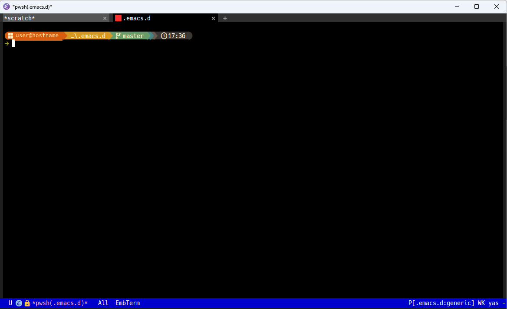
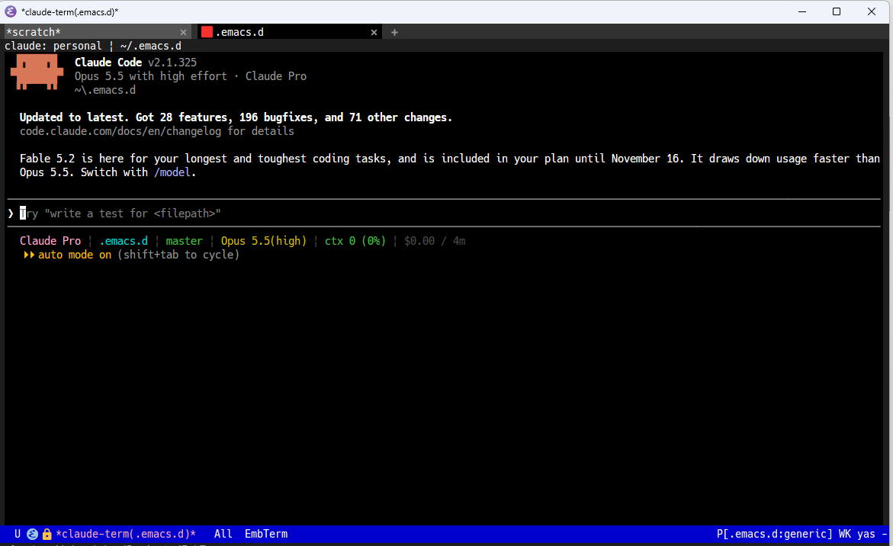

# EmbTerm

**Emacs のウィンドウの中で動く端末です。** Emacs の dynamic module が、Emacs のウィンドウの本文領域に
子ウィンドウ（HWND）を重ね、そこに端末の画面を直接描きます。VT の解釈は
[libghostty-vt](https://github.com/ghostty-org/ghostty)、PTY は ConPTY（Windows）/ `openpty`（macOS）です。

Emacs のバッファのテキストとして描かないので、**文字の幅もグリフの大きさも Emacs の表示の仕組みに縛られません。**
`①` を半角 1 桁として画面を組む claude のような TUI でも桁がずれませんし、`★` `※` が潰れることもなく、
yazi の画像プレビューもそのまま出ます。



Emacs のウィンドウに pwsh（starship + Nerd Font）を出したところです。
タブ・モードライン・ウィンドウの分割は Emacs のもので、枠の中だけを EmbTerm が描いています。
（プロンプトのユーザー名とホスト名は伏せてあります）

| | |
|---|---|
| 要件 | [docs/requirements.md](docs/requirements.md) |
| 構造 | [docs/architecture.md](docs/architecture.md)、決定の記録は [docs/adr/](docs/adr/) |
| 課題と経緯 | [docs/TODO.md](docs/TODO.md)、1 件ごとの記録は [docs/notes/](docs/notes/) |

---

## 1. できること

### 端末として

- VT の解釈（libghostty-vt）: 代替画面、スクロール領域、256 色 / true color、太字・斜体・下線（種類と色）、
  文字の点滅、ブラケットペースト、フォーカスの報告、同期出力（DEC 2026）
- **Kitty graphics**（yazi の画像プレビュー）、**Kitty keyboard protocol**、win32-input-mode
- OSC: タイトル（0 / 2）、カレントディレクトリ（7）、ハイパーリンク（8）、デスクトップ通知（9 / 777）、
  進捗（9;4）、クリップボード（52）、プロンプトの境界（133）、Emacs の関数呼び出し（51;E）
- スクロールバック（既定 10,000 行）、再折り返し（reflow）、マウスの報告（クリック・ドラッグ・ホイール）
- **eaw（`①` `★` `※` など）は 1 桁**です。グリフが全角のときの描き方は overlap（既定）と shrink から選べます
- フォントのフォールバック（日本語・Nerd Font）、`text-scale-adjust` によるバッファごとの拡大・縮小

### Emacs との繋がり

- `C-x 2` / `C-x 3` の**分割に対応**しています。分けた窓ごとに別のスクロール位置で見られます
- **copy モード**（`C-c C-k`）でスクロールバックごとバッファに写し、`C-s`・`M-w`・occur が使えます
- 選択は子ウィンドウのドラッグで行い、kill-ring にも入ります
- **日本語入力**では、変換中の文字列と候補ウィンドウが端末のカーソルの位置に出ます
  （Windows では tr-ime が必要です）
- 色は Emacs のテーマ（`default` `cursor` `region` と `ansi-color-*`）に追従します。
  テーマを変えると、開いている端末にも反映されます
- タイトルはバッファ名に、OSC 7 は `default-directory` に反映されます。
  通知・進捗・ベル・プロセスの終了は elisp のフックで受け取れます
- プロンプトの境界（OSC 133）で、前後のプロンプトへ移動（`C-c C-p` / `C-c C-n`）、
  直前の出力のコピー（`C-c C-o`）、終了コードのモードライン表示ができます
- **シェルから Emacs の関数を呼べます**（`embterm_find_file`・`embterm_dired`）
- バッファを消せば、プロセスとその子孫も終わります（Job Object）。
  Emacs が異常終了しても残りません
- 設定はすべて elisp です（`M-x customize-group RET embterm`）。設定画面も拡張言語も持ちません

### 対象外

Windows Terminal のような設定画面・コマンドパレット、端末の中のタブ・ペイン（Emacs のウィンドウで行います）、
`emacs -nw`、Linux は対象外です。

## 2. 動く環境

| | |
|---|---|
| OS | Windows 11（x86_64）。macOS でも動きます（移植済み）。Linux は対象外 |
| Emacs | GNU 公式ビルドの **31.1 以降**、**GUI フレームのみ**（`emacs -nw` は不可） |
| 日本語入力 | Windows は [tr-ime](https://github.com/trueroad/tr-emacs-ime-module) advanced（無くても使えますが、変換ウィンドウが Emacs のポイントの位置に出ます） |

## 3. インストール

**バイナリは配布していません。** 手元でビルドして、できた `target/dist/` を好きな場所に写して使います。

### 3.1 用意するもの

| | 用途 |
|---|---|
| Rust 1.95 以降（`x86_64-pc-windows-msvc`） | 本体。CRT を静的リンクするので MSVC のツールチェーンが必要です |
| **Zig 0.17.x** | libghostty-vt をソースからビルドします（Windows のみ。macOS は上流の xcframework を使うので不要です） |
| `curl` / `tar` / `certutil` / PowerShell | 依存の取得と検証に使います（どれも Windows に入っています） |

Zig の版は、libghostty-vt の `build.zig.zon` の `minimum_zig_version` と **minor まで一致**させてください。

### 3.2 ビルド

```console
git clone <このリポジトリ> EmbTerm
cd EmbTerm

cargo xtask fetch-ghostty-vt   # libghostty-vt を vendor/ghostty-vt に置く（Zig でビルド）
cargo xtask fetch-conpty       # 再配布版 ConPTY を vendor/conpty に置く（SHA256 と署名を確認）
cargo xtask dist               # release でビルドし、target/dist/ に配布物を集める
```

`target/dist/` に次のものが揃います。

```text
embterm_module.dll     Emacs の dynamic module（本体）
embterm.el             Lisp 側
embterm.exe            単体デバッグ用（Emacs 抜きで端末を開く）
conpty.dll             再配布版 ConPTY
x64/OpenConsole.exe    同上
etc/embterm.ps1        シェル統合（PowerShell）
etc/embterm.bash       同（bash: Git Bash / MSYS2 / WSL）
etc/embterm.zsh        同（zsh）
etc/embterm.lua        同（nyagos）
```

### 3.3 置き場所

`target/dist` を**普段使いの Emacs に直接読ませないでください。** `conpty.dll` と `OpenConsole.exe` が
使用中になると、次の `cargo xtask dist` と自動確認が上書きに失敗します。
別の場所に写して、そちらを読ませます。

```console
robocopy target\dist %USERPROFILE%\.emacs.d\embterm /E
```

使用中のファイルがあって写せないときは、Emacs を終えてからもう一度実行してください
（`conpty.dll` と `OpenConsole.exe` は端末が動いている間ロックされます）。

### 3.4 Emacs の設定

```elisp
(add-to-list 'load-path (expand-file-name "embterm" user-emacs-directory))
(require 'embterm)

;; 好みのキーに
(global-set-key (kbd "C-c t") #'embterm)        ; あれば切り替え、C-u で新規
(global-set-key (kbd "C-c T") #'embterm-project) ; プロジェクトのルートで開く

;; よく変えるもの
(setq embterm-shell '("pwsh" "-NoLogo")   ; 起動するコマンド
      embterm-font-family "HackGen Console NF"
      embterm-font-size 12
      embterm-scrollback-lines 50000
      embterm-narrow-wide 'overlap)       ; `①' などのグリフ: overlap（既定）/ shrink
```

- `embterm_module.dll` は `embterm.el` と同じディレクトリから読みます
  （`embterm-module-directory` で変えられます）。
- `conpty.dll` も同じディレクトリから探します（`embterm-conpty-directory`）。
  見つからなければ OS 同梱の ConPTY に落ちます。この場合、画像プレビューは出ません。
- 設定の一覧は `M-x customize-group RET embterm` で見られます。

### 3.5 日本語入力（Windows）

tr-ime advanced を入れて有効にしておけば、EmbTerm が変換ウィンドウの位置を端末のカーソルに合わせます。
EmbTerm 側の設定は `embterm-ime-position`（既定 t）だけです。

tr-ime の再変換・前後参照は、端末のバッファでは無効にしてあります（隠れたバッファを壊さないためです）。

### 3.6 シェル統合（任意）

プロンプトの境界（OSC 133）と、シェルから Emacs の関数を呼ぶ仕組み（OSC 51;E）を有効にします。
**EmbTerm の中でだけ**読み込んでください（`TERM_PROGRAM` で判定します）。
`<配布物>` は 3.3 で写した場所に読み替えてください。

```powershell
# PowerShell のプロファイル（starship などでプロンプトを決めた後で）
if ($env:TERM_PROGRAM -eq 'EmbTerm') { . "$env:USERPROFILE\.emacs.d\embterm\etc\embterm.ps1" }
Set-Alias ef embterm_find_file   # 短い名前が欲しければ
Set-Alias ed embterm_dired
```

```bash
# ~/.bashrc（Git Bash / MSYS2）
[ "$TERM_PROGRAM" = EmbTerm ] && . ~/.emacs.d/embterm/etc/embterm.bash
alias ef=embterm_find_file
alias ed=embterm_dired
```

```bash
# ~/.bashrc（WSL。Windows 側のパスを指す。WSLENV に TERM_PROGRAM を足しておく）
[ "$TERM_PROGRAM" = EmbTerm ] && . /mnt/c/Users/<名前>/.emacs.d/embterm/etc/embterm.bash
```

```lua
-- ~/.nyagos
if nyagos.env.TERM_PROGRAM == "EmbTerm" then
    dofile(nyagos.env.USERPROFILE .. "/.emacs.d/embterm/etc/embterm.lua")
end
```

```zsh
# ~/.zshrc（macOS。プロンプトを決めた後で）
[[ $TERM_PROGRAM == EmbTerm ]] && source ~/.emacs.d/embterm/etc/embterm.zsh
```

呼べる関数は `embterm-shell-commands` に載っているものだけです（既定は `find-file`・`find-file-other-window`・
`view-file`・`dired`・`dired-other-window`・`message`）。
端末に流れた文字（`cat` したファイルなど）でも呼ばれうるので、**害の無い関数にとどめてください**。
丸ごと止めるなら `(setq embterm-allow-shell-commands nil)` とします。

### 3.7 更新

読み込み済みの DLL は差し替えられません。`embterm.el` は module を一時ディレクトリに写してから読むので
ビルド自体はいつでもできますが、**新しい module を使うには Emacs の再起動が必要です。**

```console
cargo xtask dist
robocopy target\dist %USERPROFILE%\.emacs.d\embterm /E
# Emacs を再起動
```

## 4. 使い方

### 4.1 端末を開く

| コマンド | |
|---|---|
| `M-x embterm` | 端末に切り替えます。無ければ開きます。`C-u` を付けると必ず新規に開きます |
| `M-x embterm-new` | 新しい端末を開きます |
| `M-x embterm-project` | いまのプロジェクト（project.el）のルートで開きます。同じプロジェクトの端末は使い回します |
| `M-x embterm-list-buffers` | 端末のバッファを選んで切り替えます |

elisp からコマンドを指定して開くこともできます。

```elisp
(embterm-run '("claude") :directory "~/Projects/foo" :name "claude: foo")
(embterm-run (list "pwsh" "-NoLogo") :display #'pop-to-buffer)
```

### 4.2 キー

端末のバッファは **semi-char モード**で始まります。`embterm-keymap-exceptions`
（既定 `C-c` `C-x` `C-u` `C-h` `M-x` `M-:` `C-\`）**以外のキーは、すべて端末に送られます。**

| キー | |
|---|---|
| `C-c C-c` / `C-c C-z` / `C-c C-d` / `C-c C-\` | `C-c` / `C-z` / `C-d` / `C-\` を端末に送ります |
| `C-c C-k` | **copy モード**（端末を隠し、スクロールバックごとバッファに写します。Emacs のキーが効きます） |
| `C-c C-j` | semi-char モードに戻ります |
| `C-c C-p` / `C-c C-n` | 前後のプロンプトへ移動します（OSC 133。シェル統合が必要です） |
| `C-c C-o` | 直前のコマンドの出力をコピーします（同上） |
| `S-<insert>` / `C-c C-y` | kill-ring から貼り付けます（ブラケットペーストなら包みます） |
| `M-w` | 選択があればコピー、無ければ端末に送ります |
| `S-<prior>` / `S-<next>` / `S-<home>` / `S-<end>` | スクロールバックを遡る / 戻ります |
| ホイール | スクロールバックを動かします（アプリがマウスを見ていれば報告、`Shift` 付きなら必ずスクロールバック） |
| ドラッグ | 選択します（`embterm-copy-on-select` が non-nil なら kill-ring へ）。`Shift`+ドラッグはアプリより優先します |
| `Ctrl`+クリック | ハイパーリンク（OSC 8）を開きます |

キーを入力すると、そのペインはいちばん下へ戻ります。

`C-y` は端末に送ります。端末の中のアプリ（zsh の ZLE・claude など）が `C-k` で切り取った文字列は、
そのアプリの中のバッファにあって Emacs の kill-ring には入らないので、`C-y` がアプリに届かないと取り出せません。
Emacs の kill-ring から貼り付けるのは `S-<insert>` か `C-c C-y` です。`C-y` も kill-ring からの貼り付けにしたい
ときは、`embterm-keymap-exceptions` に `"C-y"` を足してください。

### 4.3 シェルごとの話

| シェル | |
|---|---|
| **pwsh / PowerShell 5.1** | PSReadLine の行編集・補完・色、starship（Nerd Font）がそのまま動きます。シェル統合は `prompt` を包むので、**プロンプトを決めた後で**読み込んでください |
| **cmd** | そのまま動きます |
| **nyagos** | 行編集・補完が動きます。シェル統合は `~/.nyagos` から読み込みます |
| **Git Bash / MSYS2** | `bash.exe --login -i` で起動します。`embterm_find_file` は `cygpath -w` で Windows のパスに直してから渡します |
| **WSL** | `wsl.exe` 経由で起動します。`wslpath -w` でパスを直します。`WSLENV` に `TERM_PROGRAM` を足しておくと統合が効きます |

子に渡す環境は Emacs の `process-environment` から作るので、`setenv` がそのまま届きます。
`TERM=xterm-256color`・`COLORTERM=truecolor`・`TERM_PROGRAM=EmbTerm` を足し、
`PWD` / `OLDPWD` と、他の端末の印（`WEZTERM_*` など）は落とします。

### 4.4 claude



```elisp
(embterm-run '("claude") :directory (project-root (project-current t)))
```

- `①` などの eaw を 1 桁で数えるので、**桁がずれません。** これが EmbTerm を作った理由そのものです
- 日本語入力では、変換中の文字列も候補ウィンドウも端末のカーソルの位置に出ます
  （claude がカーソルを隠していても出ます）
- `Shift+Enter`（改行）が使えます。`C-c` は `C-c C-c` で送ります
- デスクトップ通知（OSC 9 / 777）は `embterm-notification-functions` で受け取れます。
  既定は「Emacs が裏ならトースト、前なら `message`」です
- 進捗（OSC 9;4）はモードラインに出ます

### 4.5 yazi

**画像プレビュー**は、再配布版 ConPTY が入っていればそのまま出ます（3.2 の `fetch-conpty`）。
EmbTerm は `CSI 16t`（セルの画素の大きさ）と Kitty graphics の問い合わせに答え、XTVERSION に
`libghostty-vt` を含めて返すので、yazi は Kitty graphics の Unicode プレースホルダ方式を選びます。
OS 同梱の ConPTY では画像は出ません。

**yazi で選んだファイルを Emacs の別ウィンドウで開く**には、yazi から OSC 51;E を出します。
yazi は `--block` を付けると端末をそのままコマンドに渡すので、エスケープが EmbTerm に届きます。

1. 小さなラッパを置きます（引用符の入れ子を避けるためです。置き場所は任意です）

   ```powershell
   # %USERPROFILE%\.config\embterm-open.ps1
   param([string]$Path)
   . "$env:USERPROFILE\.emacs.d\embterm\etc\embterm.ps1"
   embterm_find_file $Path
   ```

2. yazi の `keymap.toml` に足します（古い yazi では `[[manager.prepend_keymap]]` です）

   ```toml
   [[mgr.prepend_keymap]]
   on   = "E"
   run  = 'shell ''pwsh -NoProfile -File "C:\Users\<名前>\.config\embterm-open.ps1" "$0"'' --block'
   desc = "Emacs の別ウィンドウで開く"
   ```

`$0` は今カーソルがある項目です。選択中のすべてを渡すなら `$@` にして、ラッパ側で回してください。
`embterm_find_file` の代わりに `embterm_dired` を呼べば dired で開きます。

同じことは、yazi を抜けた後のシェルからもできます。

```console
ef foo.txt      # Set-Alias ef embterm_find_file
ed .            # Set-Alias ed embterm_dired
```

## 5. 仕組みの要点

詳しくは [docs/architecture.md](docs/architecture.md) と [docs/adr/](docs/adr/) をご覧ください。
ここでは 2 点だけ説明します。

### 5.1 なぜウィンドウハンドルを取って直接描くのか

前身（ghostel）は、端末の画面を **Emacs のバッファのテキスト**として描いていました。
これだと表示が Emacs の表示の仕組みに縛られます。

- セルの幅は `char-width-table` が決めますが、**これは Emacs 全体で 1 つ**しかありません。
  「端末の中だけ `①` を 1 桁、ほかのバッファでは 2 桁」ができず、claude の画面の桁がずれます
- グリフの大きさも行の高さに縛られます（`★` `※` は 1 セルに収めるため、高さ 47% に縮められていました）
- 画像（Kitty graphics）を出す素直な手段がありません

そこで `(frame-parameter nil 'window-id)` でフレームの HWND を取り、それを親にした子ウィンドウを
`window-inside-pixel-edges` に合わせて重ね、**端末の画面は module が Direct2D で自分で描く**ことにしました
（[ADR 0002](docs/adr/0002-child-hwnd-direct-draw.md)）。
文字幅もグリフも画像も自分で決められるようになり、桁ずれは解けました。

代償として、Emacs のバッファの中身は置き物になります（`C-s` などが効きません）。
これは copy モード（`C-c C-k`）で補っています。

### 5.2 キー入力の流れ

子ウィンドウは**フォーカスを取りません**（`WS_EX_NOACTIVATE` / `MA_NOACTIVATE`）。
キーは今までどおり Emacs が受け、Emacs のキーマップから端末へ送ります
（[ADR 0004](docs/adr/0004-keys-in-emacs.md)）。

```text
キーボード
  └▶ Emacs（フォーカスはフレームにある。IME も Emacs のもの）
       └▶ embterm-semi-char-map（emulation-mode-map-alists の先頭に置く）
            ├ embterm-keymap-exceptions のキー … Emacs のコマンドとして実行（C-x、M-x、…）
            └ それ以外 … embterm--send-event / embterm--self-insert
                 └▶ embterm-module-send-key（キーの名前 + 修飾キー）※ 待たない
                      └▶ module: VkKeyScanW / MapVirtualKeyW で仮想キーを作り直す
                           └▶ アプリの求めに合わせて 3 通りのどれかで PTY へ
                                ・KKP（アプリが CSI > u で求めたとき）
                                ・win32-input-mode（ConPTY が立てているとき）
                                ・レガシーの VT（それ以外）
```

- IME の入力コンテキストは Emacs のものなので、`C-\`・漢字キー・IME のモードラインがそのまま動きます。
  変換中のキーは `VK_PROCESSKEY` になって Emacs のイベントにならないため、**端末には届きません**
  （変換中の Enter が端末に送られる心配はありません）
- 確定した文字列は「文字のキーが N 回押された」のと同じ形で届きます（1 文字につき 1 回 PTY に書きます）
- 画面に出るまでは PTY を往復します（ローカルエコーはしません）

## 6. 開発

```console
cargo test                       # クレートの単体テスト
cargo xtask test-screens         # 画面の回帰テスト（embterm.exe で動かして期待値と比べる）
cargo xtask test-emacs           # emacs -Q を別に起こして test/*.el を動かす
cargo xtask test-emacs ime       # 1 つだけ動かす
```

- `cargo xtask test-emacs` が使う Emacs は環境変数 `EMACS` で指定します
  （既定は `C:/Apps/emacs/emacs-31.1/bin/emacs.exe`）。実際にフレームを開くので、
  動かしている間は画面に窓が出ます
- `embterm.exe`（`target/dist`）は Emacs 抜きで端末を開くデバッグ用です。
  引数は [`apps/embterm/src/args.rs`](apps/embterm/src/args.rs) の先頭にまとめてあります
  （フォント・桁数・自動入力・スクリーンショット・ログなど）
- ログを取るには `(embterm-module-set-log "C:/tmp/embterm.log")` を実行します。nil を渡すとやめます

いま残っている課題は **GitHub Issues** にあります。
そこに移すまでの経緯（T-001〜T-138）は [docs/TODO.md](docs/TODO.md) に凍結してあり、
requirements.md や記録はこの T-番号で参照しています。
1 件ごとの作業の記録は [docs/notes/](docs/notes/)、調査は [docs/research/](docs/research/) です。

## 7. ライセンス

このリポジトリのコードは、**MIT**（[LICENSE-MIT](LICENSE-MIT)）または
**Apache-2.0**（[LICENSE-APACHE](LICENSE-APACHE)）のどちらかを選べます。

同梱・リンクするものは次のとおりです。

| | |
|---|---|
| libghostty-vt（と highway・simdutf・wuffs・uucode） | MIT / Apache-2.0 / BSD 系です。静的リンクするので、配布するときは表記を入れてください |
| 再配布版 ConPTY（`conpty.dll` / `OpenConsole.exe`） | Microsoft（NuGet `Microsoft.Windows.Console.ConPTY`）です。同梱して配布するときは、その条件に従ってください |
